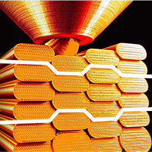
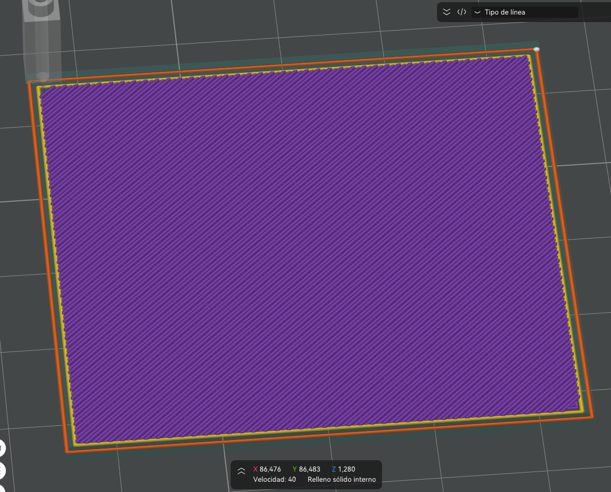
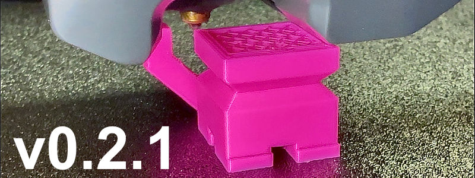
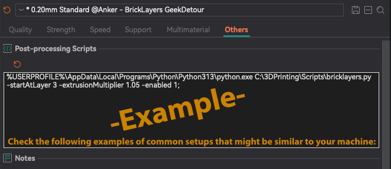
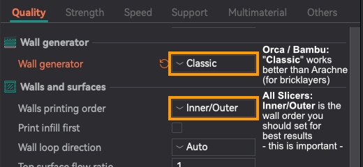
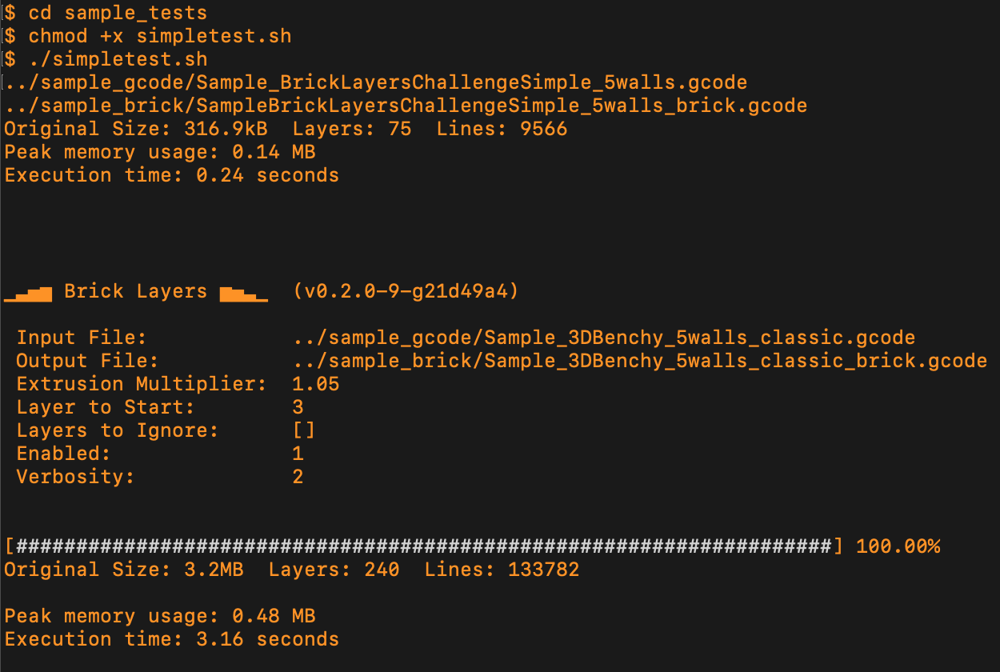

# Bricklayers + StepWeave
[]()
<a href="https://github.com/pedromxavier/flag-badges">
    
</a>&nbsp;

**BrickLayers**: Interlocking Layers Post-Processing Script for PrusaSlicer, OrcaSlicer, and BambuStudio

**StepWeave**: Técnica de entrelazado del relleno sólido a nivel micrométrico.

Este repo es un fork de [BrickLayers de GeekDetour](https://github.com/GeekDetour/BrickLayers), se ha añadido una nueva técnica para conseguir la mismas propiedades
en superficies sólidas, no solo en los bordes. Este nueva técnica es **StepWeave**.

El método **StepWeave** debe su nombre a la combinación de "Step" (por el salto vertical en el eje Z entre líneas de extrusión adyacentes) y "Weave" (por el entramado tridimensional
que se genera al entrecruzar capas monotónicas). Ésta técnica se basa en alterar la altura del eje Z durante el recorrido de relleno monotónico (por ejemplo, alternando líneas a una 
altura base Z y líneas a Z + offset, como 0.08 mm). Al imprimir la siguiente capa rotada (a 90º o en ángulos alternos), las crestas y valles se cruzan formando una micro-malla o
estructura tridimensional tipo "gofre" (waffle)

<p align=center><a url="https://www.youtube.com/watch?v=qqJOa46OTTs" alt="Brick Layers for everybody"></a> + </p>

## Revolución Mecánica y Estructural en FDM
En la impresión 3D FDM tradicional, las capas se depositan sobre planos completamente lisos, lo que convierte la delaminación en el principal fallo de este método de fabricación aditiva.
**StepWeave** revoluciona este proceso aportando:
- **Enclavamiento Mecánico (Mechanical Interlooking)**: Las crespas de una capa encajan en los valles de la capa adyacente perpendicular, creando puntos de anclaje bidireccionales que
bloquean el deslizamiento por cizalladura.
- **Aumento del Área de Contacto Real y Fusión Térmica**: La topografía ondulada incrementa la superficie de contacto entre capas, permitiendo que el plástico fluya en los micro-valles
y mejore la soldadura térmica inter-capa.
- **Isometría Mecánica**: Al cruzar las ondas y mantener el relleno monotónico, se elimina la dirección preferente de rotura, homogeneizando la rigidez en las tres direcciones.
- **Versatilidad de Aplicación**: Puede aplicarse exclusivamente en capas internas e intermedias, realizando la capa final liso (sin offset Z) para mantener el acabado estético
convencional mientras se multiplica la resistencia interna. Si se aplica en la capa superior, produce acabados funcionales (textura de agarre, hidrofobicidad Cassie-Baxter,
retención de lubricantes y acabado mate satinado por difracción de la luz)

### Comparativa con otras Técnicas de Adhesión Inter-Capa


## Infografía:


---
# Sobre esta versión: BrickLayer v0.2.1 + StepWeave 0.1

La técnica **BrickLayers** (o paredes entrelazadas) altera la altura Z de los perímetros de forma alterada y escalonada (como el trabado de los ladrillos
de una pared), con lo que se evita planos de ruptura en las paredes y bordes de las piezas impresas en FDM.



---

## Install Python or Pypy
To use the script, you need **Python 3** installed in your machine:
- [Download Python 3](https://www.python.org/downloads/) CPython, or
- [Download PyPy 3](https://pypy.org/download.html) PYPY (faster)

---

## Setup in your Slicer
Edit the **"Post processing scripts"** section in your slicer.



**Make sure to update the path** to match:
- Your **Python installation** folder.
- The folder where **you saved `bricklayers.py`**.

### **Windows Examples 🖥️**
- Normal Python (CPython):<br>
```"%USERPROFILE%\AppData\Local\Programs\Python\Python313\python.exe" "C:\3DPrinting\Scripts\bricklayers.py" -startAtLayer 3 -extrusionMultiplier 1.05 -enabled 1;```
- PYPY3:<br>
```"C:\3DPrinting\pypy3.11-v7.3.19-win64\pypy3.exe" "C:\3DPrinting\Scripts\bricklayers.py" -startAtLayer 3 -extrusionMultiplier 1.05 -enabled 1;```

### **Mac/Linux Examples 🍏 🐧**
- CPython (installed globally):<br>
```/usr/local/bin/python3 /Volumes/3DPrinting/Scripts/bricklayers.py -startAtLayer 3 -extrusionMultiplier 1.05 -enabled 1;```
- CPython (installed locally):<br>
```/Users/YourName/.pyenv/shims/python3 /Volumes/3DPrinting/Scripts/bricklayers.py -startAtLayer 3 -extrusionMultiplier 1.05 -enabled 1;```
- PyPy3 (installed globally):<br>
```/usr/local/bin/pypy3 /Volumes/3DPrinting/Scripts/bricklayers.py -startAtLayer 3 -extrusionMultiplier 1.05 -enabled 1;```
- PyPy3 (installed locally):<br>
```/Users/YourName/.pyenv/versions/pypy3/bin/pypy3 /Volumes/3DPrinting/Scripts/bricklayers.py -startAtLayer 3 -extrusionMultiplier 1.05 -enabled 1;```

### **Wall Generator** and **Walls printing order**:
In "Quality", "Walls printing order" be sure you select **"Inner/Outer"** - this is very important for the right detection of the Loops 'Depth':



In **Prusa Slicer** you can choose **Classic** or **Arachne**, both work equaly fine. 
But on **Orca Slicer** and **Bambu Studio** forks, Arachne sometimes creates orphaned loops that will turn into minor glitches in Brick Layers (I cannot fix, so far) - so I recommend **'Classic'**.

### **Disable Arc fitting** (for now)
The plan, from the beginning, is to support ARC. But it's not completely done yet - it needs an algorithm to calculate Bounding Boxes of the exact area an arc of any arbitrary angle occupies, ideally without making the script much slower.

### **Binary G-code** on Prusa Slicer:
You must **disable** `"Supports binary G-code"` in **Printers → General → Firmware** (Expert Mode)

The Binary G-code format is **incompatible with post-processing scripts**.

---

# How to see the Preview?

Saddly, none of the slicers show the changes automatically - which is weird since we can see they are running the Post-processing Script every time we slice.

We need to **drag the exported gcode file back to the Slicer** to see the results of any Post-Processing Script.

I wish this was different. Post-processing scripts would be more appealing if previewing was automatic.

More details: https://github.com/GeekDetour/BrickLayers/issues/20

---

## Command Line Interface
You can use the script to modify GCode files outside of the slicer.
First, I recommend you to check 2 examples in this file:
https://github.com/GeekDetour/BrickLayers/blob/main/sample_tests/simpletest.sh

Try running it once, as provided.

If you downloaded or cloned the repository, in your Terminal, go to the repository and:
```sh
cd sample_tests
chmod +x simpletest.sh
./simpletest.sh
```

You should see something like this:



